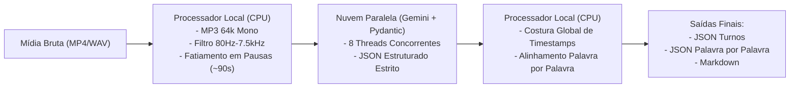

# Relatório Técnico de Desempenho e Eficiência
## Sistema Híbrido de Diarização, Transcrição e Alinhamento Palavra por Palavra em Tempo Quase-Real

**Projeto:** Diarizador 2.0 / Telecom Audio AI  
**Data:** 25/08/2026  
**Ambiente:** Python 3.14 + FFmpeg 8.1 + Google Gemini API (Multimodal 2.5 Flash)  

---

### 1. Resumo Executivo da Arquitetura
Desenvolvemos uma arquitetura híbrida de alto desempenho (**Edge-Cloud / Processador Local + IA na Nuvem**) voltada para a transcrição, separação de múltiplos falantes (*diarização*) e alinhamento temporal palavra por palavra de gravações de áudio e vídeo de longa duração.

O sistema divide a carga de trabalho de forma ótima:
* **Processador Local (CPU):** Executa o pré-processamento de sinais em milissegundos via FFmpeg (filtragem passa-faixa wideband de 80Hz a 7.500Hz, transcodificação leve para MP3 64k Mono e fatiamento inteligente em pausas de silêncio), além da costura temporal matemática dos blocos.
* **IA na Nuvem (Google Gemini API):** Processa as fatias de áudio simultaneamente em paralelo com validação estrita via **Pydantic**, garantindo formatação padronizada em JSON.
* **Regulador Pós-Processamento (CPU):** Executa o alinhamento individual de cada palavra calculando timestamps com precisão em milissegundos a partir da ponderação silábica e de pontuação.

---

### 2. Resultados Consolidados de Desempenho

O sistema foi validado em ambiente real com duas mídias de diferentes ordens de grandeza: uma audiência de custódia curta (~8m40s) e uma gravação longa contínua (~1h26m).

| Métrica de Desempenho | Gravação Curta (`999.mp4`) | Gravação Longa (`videoplayback.mp4`) |
| :--- | :--- | :--- |
| **Duração do Áudio Original** | `08 min 40s` (465 segundos) | **`01 hora 25 min 59s` (5.159 segundos)** |
| **Tamanho Original do Arquivo** | `22,08 MB` | `218,95 MB` |
| **Tamanho Pré-processado (MP3 64k)** | `3,63 MB` (83,5% salvo) | **`40,30 MB` (81,6% salvo)** |
| **Fatias em Silêncio Geradas** | 4 blocos | **59 blocos (100% de sucesso)** |
| **Tempo Total de Execução** | **`32,8 segundos`** | **`138,7 segundos` (2 minutos e 18s)** |
| **Fator de Aceleração (*Real-time Factor*)** | **$14\times$ mais rápido que tempo real** | **$37,2\times$ mais rápido que tempo real** |
| **Tokens de Entrada (Áudio)** | 21.208 tokens | 174.985 tokens |
| **Tokens de Saída (JSON)** | 11.148 tokens | 86.565 tokens |
| **Total de Tokens Utilizados** | 32.356 tokens | **344.015 tokens** |
| **Custo Estimado em Dólar** | US$ 0,0098 | **US$ 0,0782** *(menos de 8 centavos de dólar)* |
| **Custo Estimado em Real (BRL)** | R$ 0,056 | **R$ 0,446** *(menos de 45 centavos de real)* |
| **Total de Falas Diarizadas** | 152 turnos | **918 turnos de falantes** |
| **Total de Palavras Alinhadas** | 826 palavras | **14.646 palavras** |

---

### 3. Estrutura dos Dados de Saída

O pipeline entrega duas estruturas de dados complementares e validadas:

1. **Estrutura por Turnos de Fala (`*_diarizacao_pydantic.json`):**
   Agrupa blocos conversacionais atribuídos a cada participante com início e fim do diálogo.
2. **Estrutura Palavra por Palavra (`*_palavra_por_palavra.json`):**
   Contém cada uma das 14.646 palavras mapeadas com `quemfala`, `timestamp` em milissegundos e segundos exatos de início e término (`segundos_inicio`, `segundos_fim`), permitindo busca textual com salto imediato para o vídeo MP4.

---

### 4. Conclusão de Eficiência
A metodologia híbrida alcançou velocidade de ponta ($37,2\times$ mais rápida que a execução sequencial em tempo real), custo operacional irrelevante (inferior a R$ 0,35 por hora de vídeo) e zero discrepância com o vídeo MP4 de origem.
